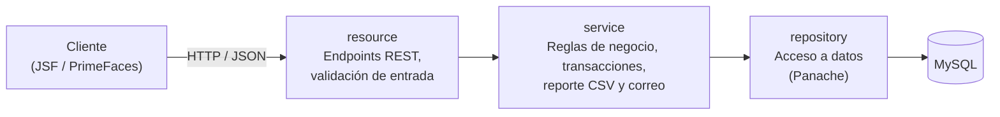
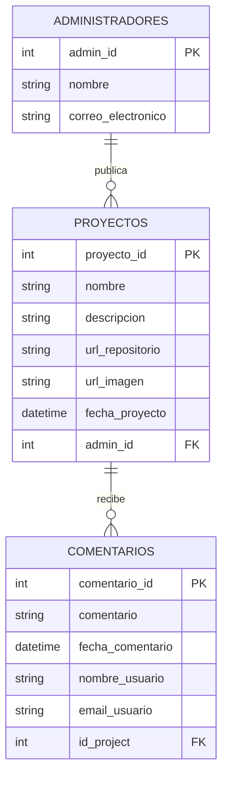

# API Portafolio de Proyectos

API REST construida con **Quarkus 3** para un portafolio personal de proyectos. Los visitantes pueden consultar los proyectos publicados y dejar comentarios sobre ellos. Cada comentario:

1. se valida y se guarda en MySQL,
2. se agrega al **reporte CSV diario**, y
3. genera un **correo de agradecimiento** para el visitante.

Todos los días a las 22:00 una tarea programada envía el reporte CSV del día por correo al administrador.

El registro de un comentario es **atómico**: si falla cualquiera de los pasos, no se guarda el comentario ni se modifica el reporte.

**Frontend:** [InterfazGraficaPrimerfaces](https://github.com/jairocodes/InterfazGraficaPrimerfaces) (JSF + PrimeFaces), que consume esta API.

## Tecnologías

| Área | Tecnología |
|---|---|
| Framework | Quarkus 3.10 (Java 17) |
| REST | Quarkus REST + Jackson |
| Persistencia | Hibernate ORM con Panache, MySQL |
| Validación | Hibernate Validator (Bean Validation) |
| Correo y tareas programadas | Quarkus Mailer, Quarkus Scheduler |
| Documentación | SmallRye OpenAPI + Swagger UI |
| Pruebas | JUnit 5, Mockito, RestAssured, H2 |

## Arquitectura

El código sigue una arquitectura en capas: cada capa solo conoce a la inmediatamente inferior.



```
src/main/java/com/jairocodes/portfolio
├── resource          Endpoints REST, respuesta paginada y manejo global de errores
├── service           Contratos de los servicios
│   └── impl          Implementaciones (ComentarioService, ProjectService)
├── repository        Repositorios Panache
│   └── api           Interfaces de los repositorios
└── model             Entidades JPA
```

### Modelo de datos

Un administrador publica muchos proyectos y cada proyecto recibe muchos comentarios.



## Endpoints

| Método | Ruta | Descripción | Respuestas |
|---|---|---|---|
| `GET` | `/Project` | Lista todos los proyectos | `200` |
| `GET` | `/Project/{id}` | Obtiene un proyecto con su administrador | `200`, `204` si no existe |
| `GET` | `/Comentario/{id}` | Obtiene un comentario con su proyecto | `200`, `204` si no existe |
| `GET` | `/Comentario?page=N` | Lista los comentarios en páginas de 10: `{ data, page, totalPages }` | `200`, `400` si `page < 1` |
| `POST` | `/Comentario/save` | Valida y registra un comentario, lo agrega al CSV y envía el correo de agradecimiento | `200`, `400` datos inválidos, `500` error al generar el reporte o enviar el correo |

Ejemplo de cuerpo para `POST /Comentario/save`:

```json
{
  "comentario": "Excelente proyecto",
  "nombreUser": "Ana",
  "emailUser": "ana@correo.com",
  "project": { "proyecto_id": 1 }
}
```

### Documentación interactiva

Con la aplicación en ejecución:

- **Swagger UI:** [http://localhost:8081/q/swagger-ui](http://localhost:8081/q/swagger-ui)
- **Especificación OpenAPI:** [http://localhost:8081/q/openapi](http://localhost:8081/q/openapi) (añade `?format=json` para obtenerla en JSON)

## Variables de entorno

La aplicación lee sus credenciales desde variables de entorno; ningún secreto está escrito en `application.properties`. Configúralas antes de ejecutarla:

| Variable | Descripción | Valor por defecto |
|---|---|---|
| `DB_USERNAME` | Usuario de MySQL | `root` |
| `DB_PASSWORD` | Contraseña de MySQL | *(obligatoria)* |
| `DB_URL` | URL JDBC | `jdbc:mysql://localhost:3306/proyectopg3` |
| `MAIL_HOST` | Servidor SMTP | `smtp.resend.com` |
| `MAIL_PORT` | Puerto SMTP | `465` |
| `MAIL_USERNAME` | Usuario SMTP | `resend` |
| `MAIL_PASSWORD` | Contraseña SMTP / API key | *(obligatoria)* |
| `MAIL_FROM` | Dirección "De" de los correos enviados | `onboarding@resend.dev` |
| `ADMIN_MAIL_RECIPIENT` | Dirección que recibe el reporte diario de comentarios | *(obligatoria)* |
| `REPORTS_OUTPUT_DIR` | Directorio donde se escribe y se lee el reporte CSV diario | `.` |
| `HTTP_PORT` | Puerto HTTP | `8081` |

## Ejecución en modo desarrollo

Requisitos: **JDK 17 o 21**, una base de datos MySQL accesible y las variables de entorno anteriores. No hace falta instalar Maven: el proyecto incluye Maven Wrapper.

> Usa JDK 17 o 21. Desde JDK 23, `javac` ya no ejecuta automáticamente los procesadores de anotaciones, por lo que Lombok no genera el código y la compilación falla.

```shell
./mvnw quarkus:dev
```

En Windows usa `mvnw.cmd quarkus:dev`.

La API queda disponible en `http://localhost:8081`, con recarga en caliente del código y la Dev UI en [http://localhost:8081/q/dev-ui](http://localhost:8081/q/dev-ui). En modo desarrollo, Quarkus Mailer funciona en modo simulado por defecto: los correos se muestran en el log en lugar de enviarse.

## Pruebas

```shell
./mvnw test
```

Las pruebas **no necesitan MySQL, Docker ni un servidor de correo**. El perfil `%test` usa:

- **H2 en memoria en modo MySQL**, con datos de `src/test/resources/import-test.sql`,
- **Mailer simulado** (`MockMailbox`) para verificar los correos enviados,
- **Scheduler deshabilitado** y reportes CSV en el directorio temporal del sistema.

| Tipo | Clases | Qué cubren |
|---|---|---|
| Unitarias (Mockito) | `ProjectServiceTest`, `ComentarioServiceTest` | Consulta por id, paginación, escritura y escapado del CSV, orden y reversión del registro atómico |
| Integración (`@QuarkusTest` + RestAssured) | `ProjectResourceTest`, `ComentarioResourceTest` | Endpoints completos, validación con Bean Validation (`400`), envío de correo y línea en el CSV |
| Integración | `ComentarioFalloCorreoTest` | Atomicidad: si el SMTP falla, no se guarda el comentario ni cambia el CSV |
| Integración | `OpenApiTest` | Generación de la especificación OpenAPI y disponibilidad de Swagger UI |

## Empaquetado

```shell
./mvnw package
java -jar target/quarkus-app/quarkus-run.jar
```

En `src/main/docker/` hay Dockerfiles para construir una imagen JVM (`Dockerfile.jvm`) o nativa (`Dockerfile.native`). Las instrucciones de construcción están en cada archivo.

## Licencia

[MIT](LICENSE)
